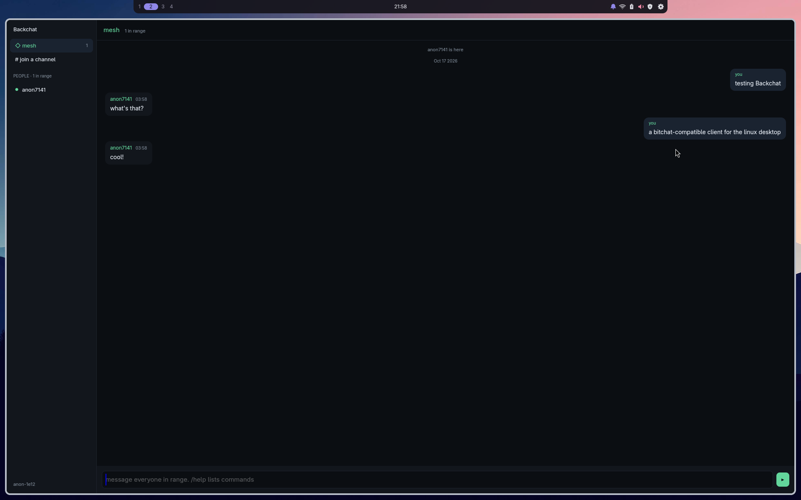

# backchat

A Rust/GPUI reimplementation of [bitchat](https://github.com/permissionlesstech/bitchat)
for Linux: bluetooth mesh chat, IRC vibes. Drop-in wire compatible with the
upstream iOS/Android clients.



Not a code fork: see [PORTING.md](PORTING.md) for how upstream is tracked
and which Swift files define wire behavior.

## Layout

- `crates/backchat-core`: pure wire format and mesh semantics: packet codec,
  TLVs, Noise_XX sessions, flood control. No I/O. Checked against upstream
  fixtures in `fixtures/`.
- `crates/backchat-nostr`: Nostr transport: geohash channels, `bitchat1:`
  embedded packets, the private-envelope scheme.
- `crates/backchat-ble`: Linux BLE mesh via BlueZ (`bluer`), central +
  peripheral roles.
- `crates/backchat`: the GPUI client: client-side titlebar (folds on
  tiling, niri included), people rail, transport-hued spaces (nearby /
  channel / private), composer.
- `fixtures/`: conformance vectors ported from upstream's test suite.
- `self/`: flatpak packaging + Orchard publishing
  ([self/packaging/README.md](self/packaging/README.md)); `scripts/build.sh`
  drives the pinned Fedora 43 container, and `scripts/vendor.sh` regenerates
  the vendored crate sources all builds consume.

## Status

**M1 working: Nostr transport.** You can join geohash channels and chat
drop-in with real bitchat iOS/Android clients over the internet.

Verified so far:
- private envelopes (kind 13/14/1059) decrypt real Android- and iOS-emitted
  fixtures (`crates/backchat-nostr/tests/envelope_fixtures.rs`)
- live publish/subscribe round-trip against `bitchat.nostr1.com`
  (`crates/backchat-nostr/tests/probe_live.rs`, network test, `--ignored`)
- BLE mesh (M2) works end-to-end against real clients: announce, public
  messages, Noise-encrypted DMs, gossip sync, dual-role radio with wedge
  self-heal (see [PORTING.md](PORTING.md) for wire facts).
- Flatpak packaging + Orchard store publishing are wired: a `v*` tag builds
  the bundle on CI, pushes the app tree to ghcr, and signs the store's
  three Nostr events ([self/packaging/README.md](self/packaging/README.md)).
  The flatpak build's BLE is verified against the phone.

## Running

No compiler on the host: everything runs in the pinned Fedora 43 container:

```sh
podman build -t localhost/bitchat-dev-rust -f containers/bitchat-dev-rust.containerfile .
./scripts/run.sh
```

A window opens: `◇ nearby` is everyone in bluetooth range; `# <geohash>`
carries location-scoped channels over relays (joining picks the 5 relays
nearest that cell from upstream's GPS relay directory); clicking a person
opens an end-to-end-encrypted DM. `/nick <name>` sets your display name;
`/help` lists commands. State lives in
`~/.local/state/backchat/`: the device seed rotates every geohash
identity, same unlinkability model as upstream.

Tests: `./scripts/build.sh test` (42 tests, all offline; one network probe
behind `--ignored`).

## License

Public domain (Unlicense), matching upstream.
